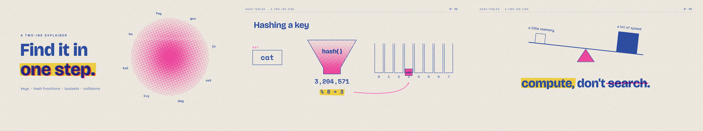

# Video Creation

An AI agent skill for making narrated, animated explainer videos: research to script, a natural voice cast for the video, a custom visual style, hand-built animation, burned-in subtitles and a finished 1080p MP4.

The skill's main idea is that **every video gets its own art direction.** Most AI-made videos share one tired look: dark background, rounded cards, pill labels, bullets fading in. This skill makes the agent invent a fresh world for each video, such as a risograph zine, a cyanotype light lab, a naturalist's atlas, a transit map or a phosphor oscilloscope. It records each style it uses so the next video looks different.

Watch the 65-second demo, made entirely with this skill (voice included): [assets/demo_hash_table_720p.mp4](assets/demo_hash_table_720p.mp4)

## Recommended model

For the best results, use **Claude Opus 5.5** (`claude-opus-5-5`). These videos depend on judgment and craft: inventing a coherent art direction, writing clear narration, choreographing dozens of synchronized animations, and then critiquing its own contact sheets and fixing them. Opus 5.5 does all of this noticeably better than smaller or older models. Other capable agents can run the skill too, but expect more iterations.

## How it works

```
narration.json ──tts.py──▶ voice clips + word timings ──timeline.py──▶ timeline, narration.wav, subtitles
style.js + scenes.js + core.js ──render.py (headless Chromium, parallel)──▶ frames ──assemble.py (ffmpeg)──▶ MP4
```

- Each frame is a pure JavaScript function of time drawn on a 1920x1080 canvas, so the agent controls every pixel and frames render in parallel and in any order.
- Every animation is tied to the narration: `cue.t(k)` is when sentence `k` of a scene starts, so visuals land on the words that explain them.
- `style_roll.py` proposes art directions from a catalog of 30 media, 18 transitions, 7 camera grammars, 10 through-lines, 5 energies, 6 layouts and 12 narrator voices. It always includes one hybrid of two media, and it skips styles you have already used.
- The narrator is cast like the visuals. With [Ming-3.0-tts](https://huggingface.co/inclusionAI/Ming-3.0-tts-0.5B), an open-weight speech model from Ant Group's inclusionAI that runs on your own GPU, the agent writes a description of the voice that fits the style ("a calm planetarium guide, a woman in her forties, soft and spacious"), and every line is spoken in that one voice. Built-in voices and cloning from a recording also work.
- Because an agent cannot listen, `tts.py` checks every line automatically: forced alignment confirms each word of the script was spoken, and a speaker-similarity check confirms the voice did not drift. Lines that fail are regenerated.
- `render.py check` automatically finds overlapping text, text off the frame and text under the subtitles; contact sheets cover the rest.
- Optional generated illustrations are keyed onto the canvas with `key_background.py`.

## Install

```bash
git clone https://github.com/Arash-san/video-creation-skill.git
cd video-creation-skill
pip install -r requirements.txt
python -m playwright install chromium
# ffmpeg and ffprobe must be on PATH (with libass, which most builds include)
python scripts/setup_ming.py   # optional, recommended: local Ming voice (NVIDIA GPU, about 4 GB free; downloads about 9 GB)
```

Without Ming the skill uses Microsoft Edge voices through `edge-tts` (free, no GPU, needs internet).

Use it as a skill:

- **Claude Code:** copy or symlink the folder to `~/.claude/skills/video-creation` (or `.claude/skills/` in a project). Then ask: *"Make a 3 minute explainer video about how TCP congestion control works."*
- **Codex:** copy it to `~/.codex/skills/video-creation`. `agents/openai.yaml` provides the display name and default prompt.
- **Any other agent** that can run shell commands: point it at `SKILL.md`.

## Quick start by hand

```bash
python scripts/new_project.py ../my-video
python scripts/style_roll.py                       # pick a direction, then --record it
# edit ../my-video/narration.json, BRIEF.md, style.js, scenes.js
python scripts/fetch_fonts.py ../my-video "Fraunces" "Outfit" "Space Mono"
python scripts/tts.py ../my-video
python scripts/timeline.py ../my-video
python scripts/render.py ../my-video sheets        # look at stills/*.png
python scripts/render.py ../my-video check
python scripts/render.py ../my-video video
python scripts/assemble.py ../my-video --name my_video --split-mb 50
```

## Repository layout

| Path | What it is |
|------|------------|
| `SKILL.md` | The instructions the agent follows |
| `references/art-direction.md` | How to invent a style, what reads as template, three case studies |
| `references/style_axes.json` | The style catalog used by `style_roll.py` |
| `references/animation.md` | Helper API and animation craft patterns |
| `references/narration.md` | Writing for the ear, honesty rules, `narration.json` format, choosing the voice |
| `references/qa.md` | Checklist before and after the full render |
| `references/illustrations.md` | Optional generated illustrations and keying |
| `scripts/` | `new_project`, `style_roll`, `fetch_fonts`, `setup_ming`, `tts` (+ `ming_worker`), `timeline`, `render`, `assemble`, `key_background` |
| `assets/template/` | The engine and stubs copied into each new project |
| `examples/hash-table/` | The full demo project (risograph zine style) |

## Notes

- Voice: Ming-3.0-tts-0.5B (MIT license) when installed, otherwise edge-tts. Ming generates slower than real time: with 3 workers, about 1.5 minutes per minute of speech on an RTX 4090 or 5090, using about 3 GB of GPU memory per worker. Lines are cached, so edits only redo the changed lines.
- In tests on the demo script, Whisper transcribed Ming's narration with no word errors (166 of 166 words), and its word timings agreed with Whisper's to a median of 72 ms.
- Fonts come from the Google Fonts repository under open licenses.
- Rendering runs at about 25 frames per second with 8 workers on a desktop CPU: the demo's 1,943 frames took about 77 seconds.

## License

MIT
